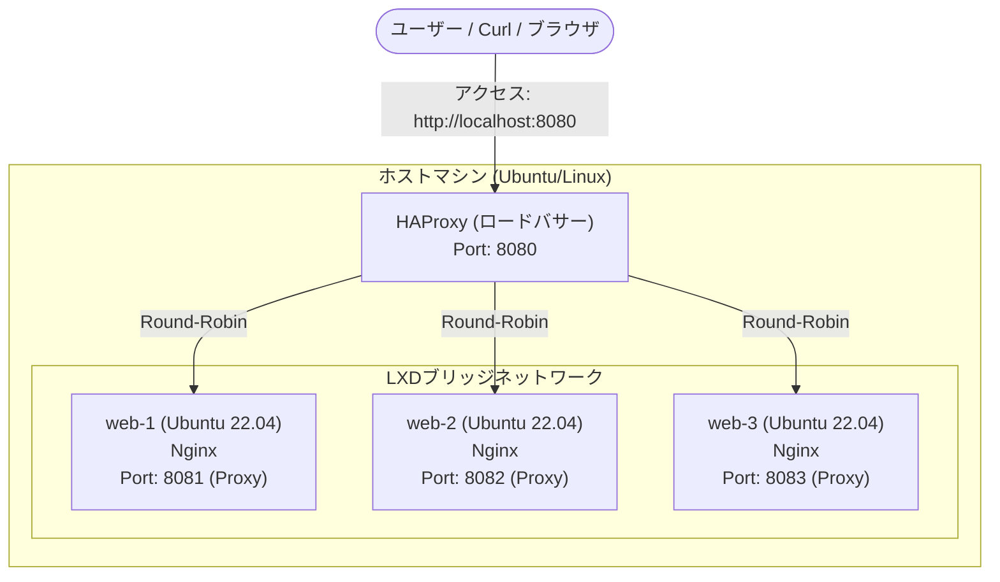

# Terraform × LXD 複数コンテナWebインフラ構築プロジェクト

## 🚀 プロジェクト概要
本プロジェクトは、AWSなどのパブリッククラウドを使用せず、**完全無料かつ高速なローカル環境（LXD）を用いて、パブリッククラウド（AWS EC2 × ELB）と同等のWebインフラを構築・コード管理（IaC）する**ことを目的とした技術検証プロジェクトです。

初期はVirtualBoxを用いた構成を検討しましたが、Terraform公式プロバイダーの不在からLXDへの移行を決定。その後、単一コンテナ構築から、複数Webサーバー（Nginx 3台）の構築、各コンテナへのポートフォワード、およびHAProxyを用いたロードバランシングまで段階的に拡張し、インフラ構築の再現性と耐障害性の基礎を習得しました。

---

## 🛠️ 技術スタック
- **IaC (Infrastructure as Code)**: Terraform (v1.x)
- **Container Virtualization**: LXD / LXC
- **OS / Base Image**: Ubuntu 22.04 LTS
- **Web Server**: Nginx
- **Load Balancer**: HAProxy
- **Scripting**: Bash / Command Line

---

## 📐 アーキテクチャ構成図


---

## 📂 構成ファイル例

### `vm.tf` (Terraform)
3台のLXDコンテナを宣言的に自動作成するための構成ファイルです。
```hcl
terraform {
  required_providers {
    lxd = {
      source  = "terraform-lxd/lxd"
      version = "1.7.0"
    }
  }
}

provider "lxd" {}

resource "lxd_container" "web" {
  count = 3

  name  = "web-${count.index + 1}"
  image = "ubuntu:22.04"
}
```

### `haproxy.cfg` (HAProxy構成一部)
```haproxy
frontend http_front
    bind *:8080
    mode http
    default_backend http_back

backend http_back
    mode http
    balance roundrobin
    server web1 127.0.0.1:8081 check
    server web2 127.0.0.1:8082 check
    server web3 127.0.0.1:8083 check
```

---

## 📝 構築ステップ

1. **LXDのインストールと初期化**
   LXDをインストールし、ストレージプールやネットワークブリッジを構成します。
   ```bash
   sudo apt install -y lxd
   sudo lxd init
   ```
2. **Terraformによるコンテナの一括構築**
   `vm.tf`を配置したディレクトリで初期化し、実行します。
   ```bash
   terraform init
   terraform apply
   ```
3. **Nginxの導入（各コンテナ内部）**
   各コンテナにログインし、Webサーバー（Nginx）をインストールします。
   ```bash
   # 例: web-1 にログイン
   lxc exec web-1 -- bash
   
   # コンテナ内部で実行
   sudo apt update
   sudo apt install -y nginx
   ```

4. **Webコンテンツの変更（動作確認用）**
   各コンテナのコンテンツを変更し、アクセス先のコンテナが判別できるようにします。
   ```bash
   # web-1 内で実行
   echo "This is web-1" | sudo tee /var/www/html/index.html

   # web-2 内で実行
   echo "This is web-2" | sudo tee /var/www/html/index.html

   # web-3 内で実行
   echo "This is web-3" | sudo tee /var/www/html/index.html
   ```

5. **ポートフォワーディング（Proxyデバイスの追加）**
   ホスト側の特定ポート（8081〜8083）からコンテナの80番ポートへの通信経路をマッピングします。
   ```bash
   lxc config device add web-1 http proxy listen=tcp:0.0.0.0:8081 connect=tcp:127.0.0.1:80
   lxc config device add web-2 http proxy listen=tcp:0.0.0.0:8082 connect=tcp:127.0.0.1:80
   lxc config device add web-3 http proxy listen=tcp:0.0.0.0:8083 connect=tcp:127.0.0.1:80
   ```

6. **HAProxyの導入とロードバランシング設定**
   ホスト側にHAProxyを導入し、`localhost:8080`へのリクエストを3台のコンテナへ分散させます。

---

## 🔧 トラブルシューティングと解決策
本構築にあたり、いくつかのトラブルに遭遇し、ログの確認や設定の最適化を行って解決しました。

### 1. VirtualBoxプロバイダーの初期化エラー
- **事象**: VirtualBoxをTerraformで管理しようとしたが、`hashicorp/virtualbox`プロバイダーが公式レジストリから取得できず `terraform init` が失敗。
- **原因**: サードパーティ製のプロバイダーであり、手動インストール等が必要であった。
- **解決策**: ローカルで高速かつ軽量にコンテナ型VMを構築でき、公式プロバイダーも用意されている「LXD」へ切り替え。学習の初期段階としてよりスマートな検証方法を採用した。

### 2. LXDソケットへのアクセス権限エラー (Permission Denied)
- **事象**: `terraform apply` 実行時に以下のエラーが発生。
  `dial unix /var/snap/lxd/common/lxd/unix.socket: connect: permission denied`
- **原因**: 実行ユーザーが `lxd` グループに所属していなかったため、LXDデーモンと対話するためのソケットファイルへのアクセス権限が不足していた。
- **解決策**: ユーザーを `lxd` グループに追加し、ホストを再起動（またはセッション再読み込み）して権限を反映。
  ```bash
  sudo usermod -aG lxd $USER
  sudo reboot
  ```

### 3. リソース重複エラー (State不整合)
- **事象**: コンテナ作成時に `This "instances" entry already exists` とエラーが発生。
- **原因**: LXD上に手動または古い適用で残っていた `terraform-test` コンテナがあり、新しく適用しようとしたTerraformの管理対象（State）と競合していた。
- **解決策**: 重複している既存コンテナを強制削除した上で、Stateから古い情報を除外。
  ```bash
  lxc delete terraform-test --force
  terraform state rm lxd_container.test
  ```

### 4. LXD初期化時のストレージプール名競合
- **事象**: `lxd init` の設定中に、ストレージプール `default` が作成できないエラーが発生。
- **原因**: 以前のLXD環境が作成した同名のストレージプールが残っていた。
- **解決策**: 初期化プロンプトで新しいプール名（例: `default2`）を指定することで競合を回避。

---

## 💡 プロジェクトを通じた学びと成長
- **手動から自動化へ (IaCの価値実感)**: サーバーを1台ずつ手動構築する手間から解放され、コード定義による「環境の再現性」と「スケールアウト（`count`の増減）」の俊敏性を実体験できました。
- **インフラの基礎知識の向上**: コンテナネットワーク、ポートフォワーディング、リバースプロキシ、およびロードバランサー（レイヤー4/7分散）の理論と設定手順をハンズオンを通じて体系的に整理できました。
- **トラブルシューティング力**: エラーメッセージを正しく読み解き、UNIXソケットやOSのユーザーグループ権限、Terraform의 State管理（状態管理ファイル）の仕組みを理解した上で原因究明を行うスキルが身につきました。
