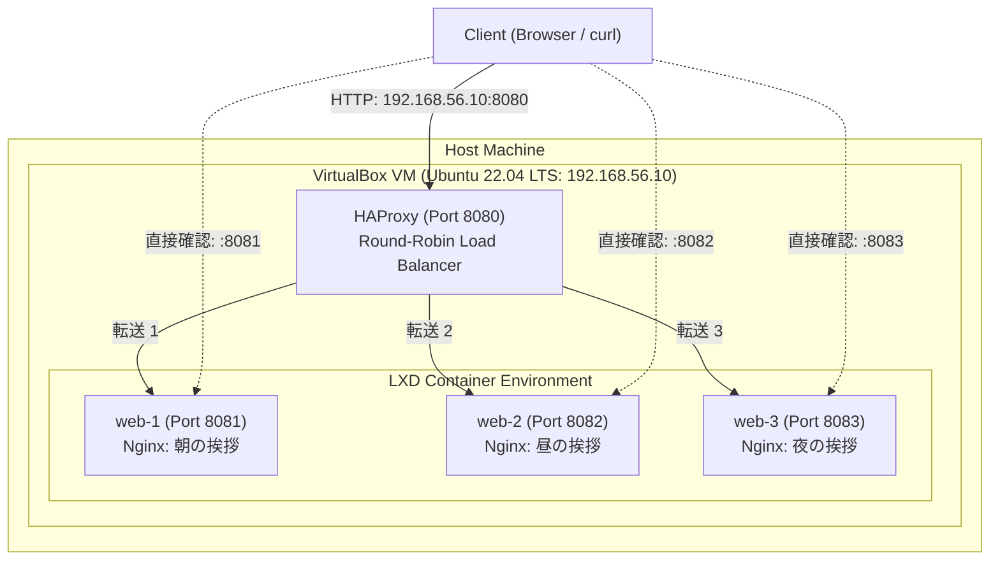

# Terraform × LXD Auto Environment (Vagrant + Ansible + Terraform + LXD + HAProxy)

[](https://www.terraform.io/)
[](https://linuxcontainers.org/lxd/)
[](https://www.haproxy.org/)

本リポジトリは、**Vagrant × Ansible × Terraform × LXD × HAProxy** を組み合わせ、3台のコンテナによる Web クラスタおよび負荷分散環境を、**`clone` → `vagrant up` の 1 コマンドのみで完全再現**できるように構築した IaC (Infrastructure as Code) プロジェクトです。

---

## 🎯 目的・背景
企業側・レビュアーが「環境差異や面倒な手動手順なしに、**1コマンドで動作する環境を完全に手元で再現・検証**できること」を最優先に設計しています。
ホストOS（Windows / macOS / Linux）に Ansible や Terraform、LXD がインストールされていなくても問題ありません。VM 内部で Ansible (`ansible_local`) が自動実行され、LXD 環境初期化、Terraform によるコンテナ・プロキシ自動プロビジョニング、HAProxy の構成まで一貫して全自動で完了します。

---

## 🏗️ システムアーキテクチャ



---

## 📁 ディレクトリ構成

```text
terraform-lxd-auto-env/
├── Vagrantfile                         # Ubuntu 22.04 VM 定義 & ansible_local 実行定義
├── provision/
│   ├── playbook.yml                    # メイン Ansible Playbook
│   └── roles/
│       ├── lxd/
│       │   └── tasks/main.yml          # LXD snap インストール & 初期化
│       ├── terraform/
│       │   └── tasks/main.yml          # Terraform 導入 & プロジェクト配布 & 実行
│       └── haproxy/
│           └── tasks/main.yml          # HAProxy 導入 & ラウンドロビン負荷分散設定
├── terraform/
│   └── main.tf                         # LXD コンテナ 3台、Nginx、Proxy デバイス定義
├── .gitignore                          # Terraform/Vagrant 成果物の除外設定
└── README.md                           # プロジェクト説明書（本ドキュメント）
```

---

## 🧩 自動構築される内容

1. **VirtualBox 仮想マシン (Ubuntu 22.04 LTS)**: 2 CPU / 4096 MB RAM / IP: `192.168.56.10`
2. **LXD 初期化**: `lxd init --auto` によるストレージプール (`default`)・ブリッジ (`lxdbr0`)・基本プロファイルの自動構成
3. **Terraform 環境**: Linux amd64 バイナリの導入、`terraform-lxd/lxd` プロバイダーのセットアップ
4. **LXD コンテナ 3台**: `web-1`, `web-2`, `web-3` を Ubuntu 22.04 ベースで自動作成
5. **Web サーバー & コンテンツ**:
   - 各コンテナ内部で Nginx 自動インストール
   - それぞれ異なる挨拶（朝・昼・夜 / 日英併記）のレスポンスページを自動生成
6. **LXD Proxy デバイス**: ホストポート `8081`, `8082`, `8083` から各コンテナの `80` 番ポートへプロキシ転送
7. **HAProxy 負荷分散**: ポート `8080` でリクエストを受け付け、3台の Web コンテナへラウンドロビン均等分散

---

## 🚀 再現手順（企業・レビュアー向け）

### 1. 前提条件
ホスト PC に以下がインストールされている必要があります：
- [VirtualBox](https://www.virtualbox.org/) (v6.1 以上 または v7.x)
- [Vagrant](https://developer.hashicorp.com/vagrant/downloads) (v2.3 以上)

> [!NOTE]
> ホスト OS への Ansible や Terraform の事前インストールは **不要** です。

### 2. リポジトリのクローン
```bash
git clone https://github.com/yourname/terraform-lxd-auto-env.git
cd terraform-lxd-auto-env
```

### 3. 環境の自動起動（ワンコマンド）
```bash
vagrant up
```
*※ 初回起動時は Box の取得、LXD コンテナイメージのダウンロード、パッケージ導入を含めて数分で完了します。*

---

## 🖥️ 動作確認

プロビジョニング完了後、ホスト OS のブラウザまたはターミナルからアクセスして動作を確認します。

### 1. 負荷分散の確認（HAProxy 経由）
ブラウザから [http://192.168.56.10:8080](http://192.168.56.10:8080) にアクセスし、リロードするたびにサーバーが順番に切り替わる（朝 → 昼 → 夜）ことを確認できます。

ターミナルから連続アクセスして確認する場合：
```bash
# curl で 6回リクエストを送信（2周分ラウンドロビンされることを確認）
for i in {1..6}; do curl -s http://192.168.56.10:8080 | grep -E "(おはようございます|こんにちは|こんばんは)"; done
```

**出力例：**
```text
    <h1>おはようございます、1番のサーバーです。</h1>
    <h1>こんにちは、2番のサーバーです。</h1>
    <h1>こんばんは、3番のサーバーです。</h1>
    <h1>おはようございます、1番のサーバーです。</h1>
    <h1>こんにちは、2番のサーバーです。</h1>
    <h1>こんばんは、3番のサーバーです。</h1>
```

### 2. 個別サーバーへの直接確認（Proxy デバイス経由）
- **web-1 (朝)**: [http://192.168.56.10:8081](http://192.168.56.10:8081)
- **web-2 (昼)**: [http://192.168.56.10:8082](http://192.168.56.10:8082)
- **web-3 (夜)**: [http://192.168.56.10:8083](http://192.168.56.10:8083)

---

## 🛠️ 主な運用・検証コマンド

```bash
# VM 内部へ SSH ログイン
vagrant ssh

# VM 内部で LXD コンテナの状態を確認
vagrant ssh -c "lxc list"

# VM 内部で HAProxy のステータスを確認
vagrant ssh -c "sudo systemctl status haproxy"

# 設定変更後の再プロビジョニング
vagrant provision

# VM の一時停止 / 再開
vagrant suspend
vagrant resume

# VM のシャットダウン
vagrant halt

# 環境の完全削除（クリーンアップ）
vagrant destroy -f
```

---

## 💡 技術的なこだわり・工夫

- **ポータビリティの最大化 (`ansible_local`)**:
  Windows ホスト環境ではホストOS上に Ansible を直接動作させることが困難です。本リポジトリでは Vagrant の `ansible_local` プロビジョナーを採用することで、VM 内部に Ansible を自己解決させ、どの OS でも確実に 1 コマンドで動作するように設計しています。
- **IaC の役割分担の明確化**:
  - **Vagrant**: 開発環境用 VM のライフサイクル管理
  - **Ansible**: OS の基盤ソフトウェア（LXD、Terraform、HAProxy）の構成管理
  - **Terraform**: LXD インフラリソース（コンテナ、Proxy デバイス）の宣言的管理
- **冪等性と耐障害性の担保**:
  - `terraform-lxd/lxd` 公式プロバイダーの明示指定
  - コンテナ起動直後の `apt` 排他ロック（unattended-upgrades 等）の競合を回避する待機ロジックの組み込み
  - HAProxy の必須タイムアウト値（`timeout connect`, `timeout client`, `timeout server`）を完備した安全な設定生成
